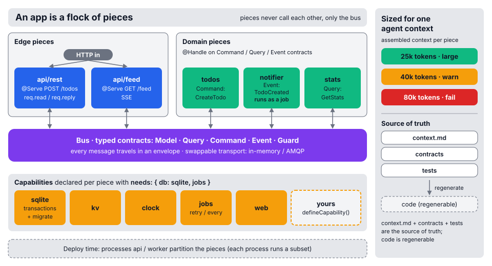
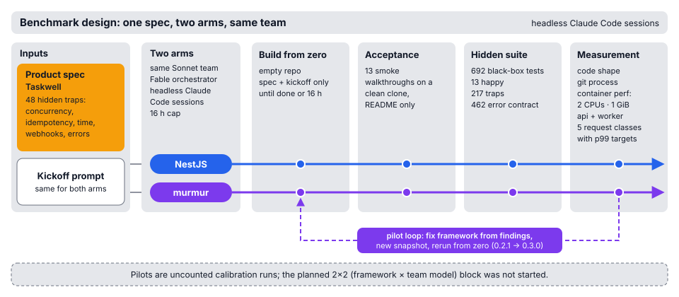
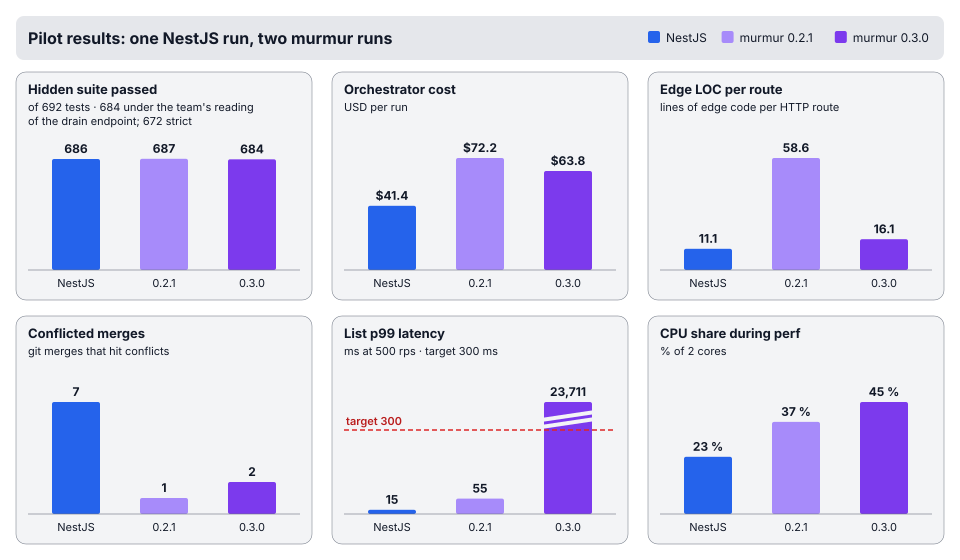

# murmur

An agent-first application framework, and the benchmark that told us to stop building it.

## TL;DR

**The idea.** Agent teams struggle with big shared codebases, so build the framework around the agent: an app is a
flock of small independent pieces that only talk through a typed message bus, each piece sized to fit one agent's
context window, with the cross-cutting machinery (auth, idempotency, jobs, transactions, clock) owned by the
framework and a CLI that gives every agent a one-screen brief and a strict lint.

**The test.** A hard product spec with 48 planted traps (217 trap tests), a hidden suite of 692 black-box tests, and the
same Claude Code engineering team building it on NestJS once and on murmur twice. Acceptance on a clean clone,
then the suite, then code, git and container performance measurements.

**The result.** A tie on correctness (NestJS 686, murmur 0.2.1 687, murmur 0.3.0 684 or 672 strict, of 692, with the
same three traps missed by every build), murmur more expensive ($64–72 vs $41 per build, as reported by Claude Code), bigger apps (11.7k vs 8.9k lines), fewer merge conflicts (1–2 vs 7), and
about three times the CPU per request. The second murmur build collapsed under load: its rate limiter wrote to SQLite on
every request, where the first build had kept counters in memory. One run per configuration, Sonnet teams only,
uncounted pilots: a clear signal, not a proof.

**The call.** A negative result, measured, so the project stops here. The framework is frozen at 0.3.0, the lab is
published alongside it as the part worth reusing, and the write-up is here:
[post-mortem](docs/research/post-mortem.md), [results](docs/research/results.md), [timeline](docs/research/timeline.md).

**How it was made.** Two days, about 280 commits during development squashed to three for publication, no code written
by hand. The author set the direction, made the scope and stop/go calls, delegated some design calls to the agents (the
decisions log says which) and reviewed the results; Claude agent teams driven through Claude Code workflows wrote the framework, the
example app, the lab, the hidden tests, the reference implementation, the pilots and this text. Details in
[How it was built](#how-it-was-built). Treat the repository as a documented concept experiment, not a product.

## The idea



A piece is a class with handlers for typed contracts. It declares the capabilities it needs and the events it emits,
and it never imports another piece. Contracts are Zod schemas with a kind: Model, Query, Command, Event, Guard.

```ts
export class Todo extends Model({ id: z.string(), title: z.string(), done: z.boolean() }) {}
export class CreateTodo extends Command({ title: z.string().min(1).max(200) }, Todo) {}
export class TodoCreated extends Event({ id: z.string(), title: z.string() }) {}
```

```ts
export class Todos extends Piece({
  needs: { db: sqlite, jobs },
  emits: [TodoCreated, TodoCompleted, TodoRemoved],
}) {
  @Handle(CreateTodo)
  async create(input: CreateTodo, delivery: Delivery): Promise<Todo> {
    const fresh = { id: this.ids.uuid(), title: input.title, createdAt: this.clock.now().toString() };
    const claim = await this.db.transaction(async (tx) => this.#claim(tx, delivery.envelope.id, fresh));

    if (!claim.announced) {
      await this.emit(TodoCreated, { id: claim.todo.id, title: claim.todo.title });
      await markAnnounced(this.db, delivery.envelope.id);
    }

    return claim.todo;
  }
}
```

Edge pieces serve HTTP and forward to domain contracts; guards run in order and reject by returning a value;
`idempotent` routes, retries, schedules and transactions are framework features, not app code.

```ts
export class RestApi extends Piece() {
  @Serve(web.post('/todos', { status: 201, idempotent: { scope: ['auth.userId'] } }))
  async create(req: WebRequest): Promise<HttpResult> {
    const { body } = await req.read({ body: CreateTodo.input });
    const todo = await this.request(CreateTodo, body);

    return req.reply(todo, { headers: { location: `/todos/${todo.id}` }, etag: etagOf });
  }
}
```

`murmur check` enforces the structure (no cross-piece imports, sizing caps, exhaustive switches, no comments, explicit
return types) and `murmur ctx <piece>` prints the brief an agent needs to rewrite that piece from scratch. The full
example lives in [`examples/todo-api`](examples/todo-api) and is reproduced, test-enforced, in
[`docs/api-preview.md`](docs/api-preview.md).

## The experiment



- [`lab/SPEC.md`](lab/SPEC.md) is "Taskwell": users, API keys, workspaces, roles, projects, tasks, comments, activity,
  search, webhooks with signed retries, digests and reminders on an application clock, idempotency keys, optimistic
  concurrency, rate limits, keyset paging, and a precise error contract. [`lab/experiment/TRAPS.md`](lab/experiment/TRAPS.md)
  maps every planted difficulty to its spec sentence and its hidden test.
- Teams got `SPEC.md` and `SMOKE.md`, nothing else. The hidden suite ([`lab/suite`](lab/suite)), the traps, the
  phase-2 change requests and the reference implementation stayed sealed until the experiment closed. Only one of the
  three pilots ran as an isolated OS user; the other two were sealed by session deny rules and a runs root outside
  the lab, not by file permissions.
- Same headless Claude Code session shape for both arms: a Fable orchestrator, a Sonnet team, one kickoff prompt,
  a 16-hour cap. Acceptance follows the team's README on a clean clone. Perf runs in a 2-CPU, 1 GiB container with
  API and worker together, five request classes at planned rates against the spec's p99 targets.
- The murmur arm ran on a loop: build, read the framework issues and the code shape, fix the framework, cut a new
  snapshot, rebuild from zero. 0.2.1 became 0.3.0 that way, between pilots 1 and 2.

Procedure, gates and every finding: [`lab/experiment/EXPERIMENT.md`](lab/experiment/EXPERIMENT.md).

## Results



|                        |     NestJS | murmur 0.2.1 | murmur 0.3.0 |
| ---------------------- | ---------: | -----------: | -----------: |
| Hidden suite, of 692   |        686 |          687 |        684 ¹ |
| Wall clock             | 2 h 44 min |   1 h 47 min |   1 h 55 min |
| Agents / cost          |   31 / $41 |     84 / $72 |     50 / $64 |
| Source LOC             |      8,930 |       11,971 |       11,699 |
| Edge LOC per route     |       11.1 |         58.6 |         16.1 |
| Conflicted merges      |          7 |            1 |            2 |
| Framework issues filed |          0 |            9 |            3 |
| Perf targets met, of 5 |          5 |            5 |            3 |
| CPU share, 2 cores     |       23 % |         37 % |         45 % |
| API memory             |    146 MiB |      218 MiB |      383 MiB |

¹ 672 under the suite's strict reading of one spec sentence about the test-mode drain endpoint; the team's reading
is defensible and both numbers are reported.

What v0.3 fixed: edge boilerplate (−72 %), the app-local helper layer (3,800 lines to 65), the issue count. What it
did not fix: cost, app size, correctness. What it broke: performance, through a write-per-request rate limiter the team
built on 0.3.0's durable-storage path. The long version, including the things we are not sure about and what we would do
differently, is the [post-mortem](docs/research/post-mortem.md).

## How it was built

The process may be more reusable than the framework. One person acted as product owner over agent teams, and the
teams were structured, not prompted ad hoc. The workflow scripts and session transcripts are not published; the
design doc and the decisions log are the trace.

- **Design by panel.** The v0.3 redesign ran as a workflow: four readers extracted evidence from the pilot code in
  parallel, three designers proposed strict, composable and minimal variants, a judge scored them, a critic listed
  sixteen must-changes, a synthesiser wrote the final design. About forty minutes, one document, every decision
  recorded with its reason.
- **Build by chain.** Ten milestones implemented in sequence, each with one implementer, one reviewer and at most one
  fix round, stopping on the first red check. The chain ran unattended for five and a half hours and landed green.
- **Memory the agents own.** `.agents/` holds the brief, the spec, the design doc and a decisions log. Agents were
  instructed to read the relevant doc first and to log lasting decisions in `.agents/decisions.md`; `AGENTS.md` holds
  the rules every session loaded.
- **Measure, then change.** The framework only changed in response to what the pilot teams actually did: the issues
  they filed, the code they duplicated, the helpers they built. Each change had to be generic, never shaped to the
  benchmark app. The planned changelog-vs-traps disclosure (`lab/experiment/FRAMEWORK-CHANGELOG-vs-TRAPS.md`) was
  never filled because the experiment stopped at the pilots; several v0.3 features sit in trap categories, which if
  anything favoured murmur.
- **Model by task.** Fable for design, judging, critique and orchestration; Opus for implementing and reviewing the framework
  and the lab; Sonnet for the teams under test, so the result says something about a mid-tier model.

## What is worth taking from this

- The lab. A spec written to be hard, a trap map, a hidden black-box suite, acceptance on a clean clone, and a
  container perf rig. It works for comparing models, team workflows, or frameworks of your own. [`lab/README.md`](lab/README.md).
- Context-sized modules and a strict, lint-enforced house style as conventions on any stack. `murmur ctx` and
  `murmur check` kept both murmur codebases lint-clean and uniform in shape; we did not measure quality beyond that,
  and the runtime underneath added cost without a measurable benefit.
- Piece boundaries do cut merge conflicts. They just did not cut anything else.

## The framework, frozen

murmur 0.3.0 is complete enough to build a real app on (pilot 2 did) and is not maintained. Packages:

| Package                                              | What                                                                                                                      |
| ---------------------------------------------------- | ------------------------------------------------------------------------------------------------------------------------- |
| `murmur`                                             | Core: envelope, contracts, `Piece`, bus semantics, admission, rejections. No runtime dependencies.                        |
| `@murmur/node`                                       | Node runtime: `defineApp`, processes, HTTP capability, sqlite, kv, clock, jobs, email sink, testing helpers, `#lib` lane. |
| `@murmur/transport-memory`, `@murmur/transport-amqp` | Swappable bus transports.                                                                                                 |
| `@murmur/cli`                                        | `murmur check`, `ctx`, `catalog`, `new`, `start`, `dev`, `migrate`, `test`, `tail`, `trace`, `emit`, `doctor`.            |
| `@murmur/lint`                                       | oxlint preset and the type-aware checks.                                                                                  |
| `@murmur/dev-protocol`, `@murmur/ui`                 | Dev server protocol and the web UI.                                                                                       |
| `plugins/murmur`                                     | The Claude Code plugin: piece-writer and piece-reviewer agents, skills, hooks.                                            |

Known open issues, left as they are: `murmur check --fix` rewrites `\u` escapes in regular-expression literals into
raw characters; `req.read` rejects a `z.record` body part and does not export `ReplyBody`; there is no API to purge
the jobs queue; the runtime idles at about 4 % of a core; per-request overhead is about 3.5× NestJS per list request.

The specification is [`.agents/docs/spec.md`](.agents/docs/spec.md), the design intent is
[`.agents/docs/brief.md`](.agents/docs/brief.md), and the evidence-driven v0.3 redesign is
[`.agents/docs/design-v0.3.md`](.agents/docs/design-v0.3.md). `.agents/` is the project's own memory: the agents
that built murmur read it before working, which is why it is kept as part of the record.

## Install

Node 26 and pnpm 12.

```sh
pnpm install
```

The lab packages are standalone; see [`lab/README.md`](lab/README.md) for running the hidden suite against any
Taskwell implementation and for the container perf measurement.

## Repository

```
packages/        the framework (erasable TypeScript, Node 26, pnpm workspace)
plugins/murmur   Claude Code plugin
examples/        todo-api, the reference app the docs are checked against
docs/            framework docs, framework-readme.md (the README the pilot teams read), docs/research/ (post-mortem, results, timeline, diagrams)
lab/             the benchmark: spec, smoke, hidden suite, traps, harness, reference implementation, pilot results
.agents/         brief, spec, design doc, decisions log
scripts/release  snapshot, publish and verify against a local npm registry (how the teams got murmur)
```

```sh
pnpm check          # lint, typecheck, tests across the workspace
pnpm example        # examples/todo-api in dev mode with the UI
```

## License

MIT.
